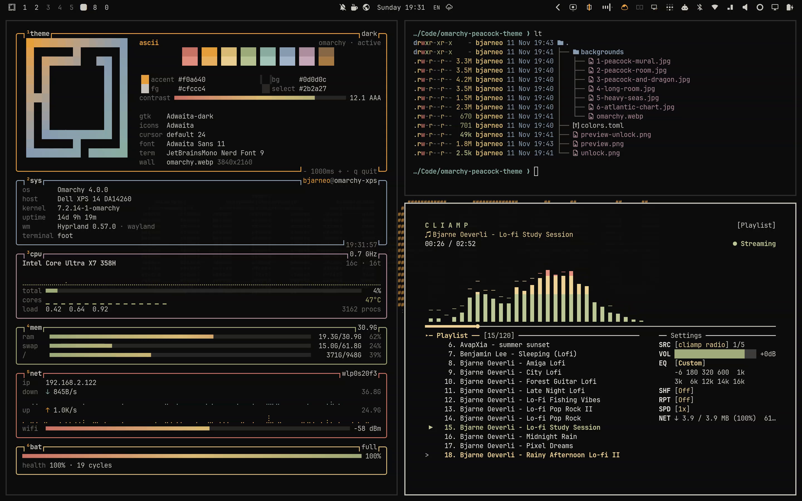

# ASCII

An Omarchy 4.5 theme built from ink, paper, and one amber phosphor.

Every glyph in every wallpaper, intro, and lock logo is printable 7-bit ASCII (0x20–0x7E), and each wallpaper carries exactly one amber element.



## Install

```bash
omarchy-theme-install https://github.com/bjarneo/omarchy-ascii-theme
```

You can also copy the folder to `~/.config/omarchy/themes/ascii`. Then pick it with `Super + Ctrl + Shift + Space`.

## What ships

| File | Purpose |
|---|---|
| `colors.toml` | The palette. Every generated config (terminals, Hyprland, Neovim via aether, VS Code, helix, fcitx5, …) comes from it. |
| `shell.*.toml` | Section overrides for the Omarchy shell: an opaque flat bar, hairline controls with amber focus, an amber gutter on the selected menu or launcher row, margin-note notifications (4px left rule), and a lock field that idles in paper, turns amber while you type, and red on error. |
| `btop.theme` | Quiet graphite box outlines. Graphs run from graphite to paper, and only the top of the range turns amber. |
| `backgrounds/` | `1-luna`, `2-contour`, `3-ridges`, `4-ascii-7`, and `omarchy`, all 3840×2160 lossless WebP. |
| `backgrounds/intros/` | One 6s intro per background (2560×1440, H.264, 30fps). Cells scramble through random ASCII, lock in with a short phosphor flash, and land on the still. |
| `unlock.png` | The Omarchy icon redrawn in `#` with a dotted shadow, for Plymouth and SDDM. |
| `preview.png`, `preview-unlock.png` | Previews for the theme picker and the boot screen. |

The palette and shell files are colour only. A theme installed from git therefore keeps all of it, while Omarchy generates any Lua and terminal configs from `colors.toml`.

## Palette

| Role | Hex |
|---|---|
| background | `#0d0d0c` |
| foreground | `#cfccc4` |
| bright_foreground | `#f4f1e8` |
| accent | `#f0a640` |
| selection | `#2b2a27` |
| muted | `#55534e` |

The ANSI colours are deliberately muted (`#d0786a` red, `#a3b07e` green, `#8ea3b8` blue, …), so diffs and syntax stay readable without breaking the monochrome feel.

## Recommended

A monospace font keeps the ASCII grid honest. The previews use JetBrainsMono Nerd Font, which is Omarchy's default.

## License

ASCII is released under the [MIT License](LICENSE).
